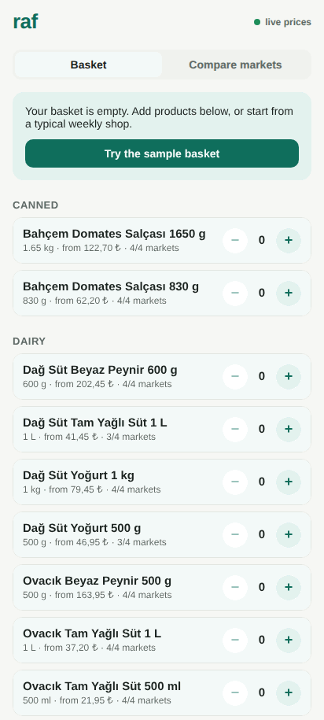
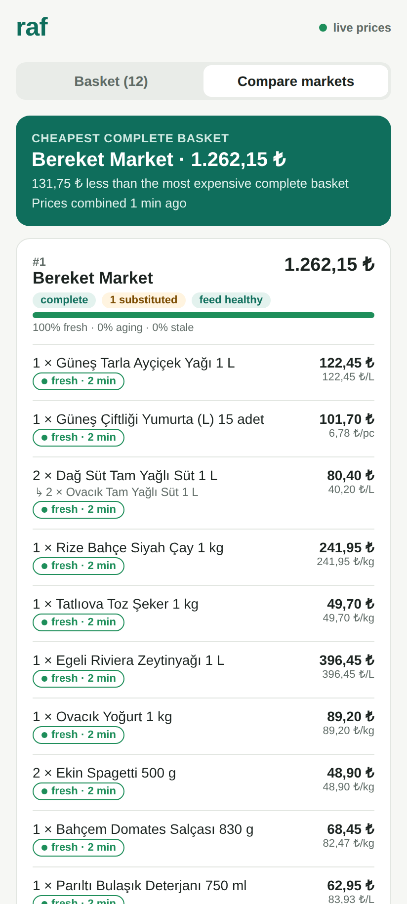
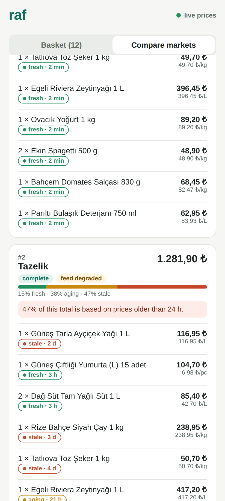
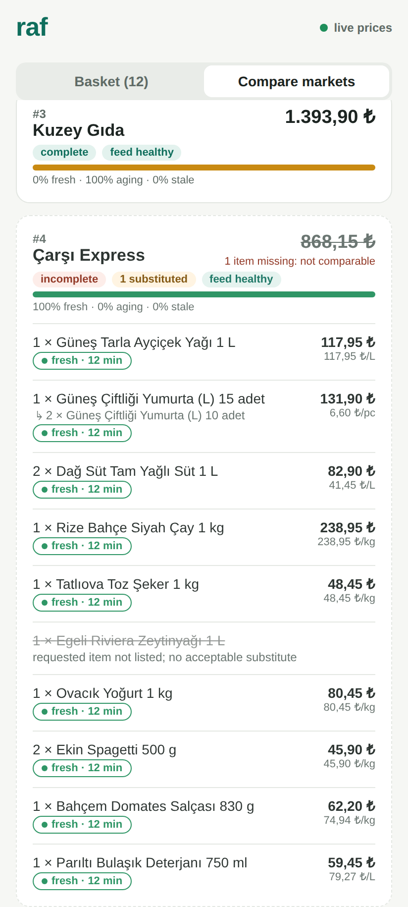
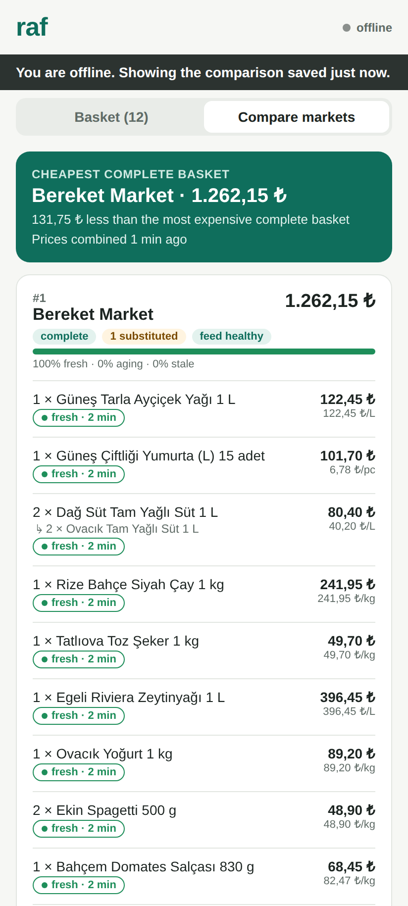
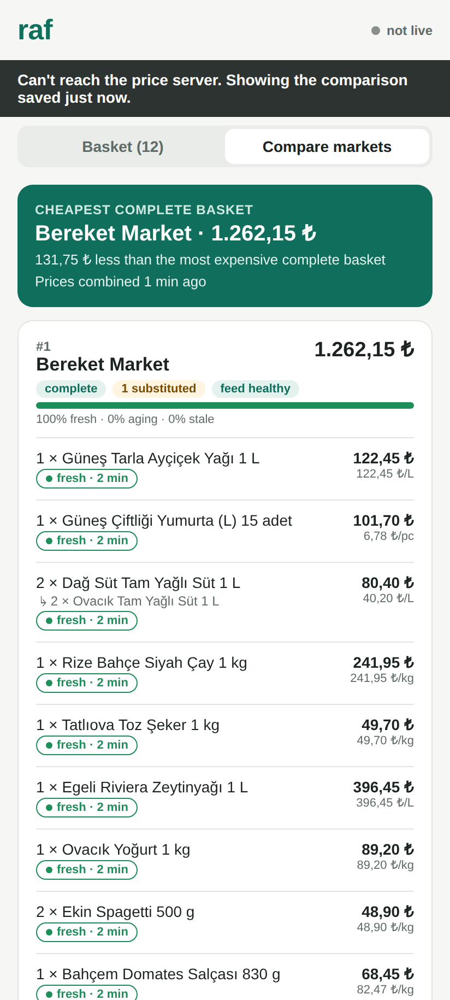
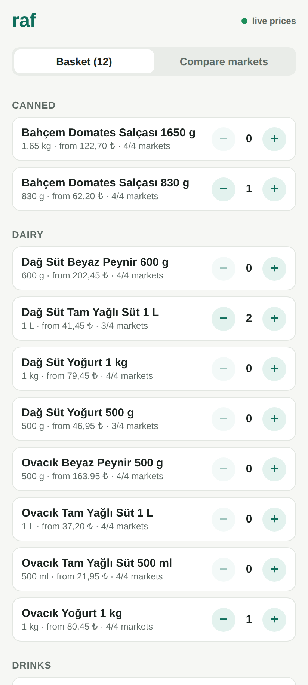
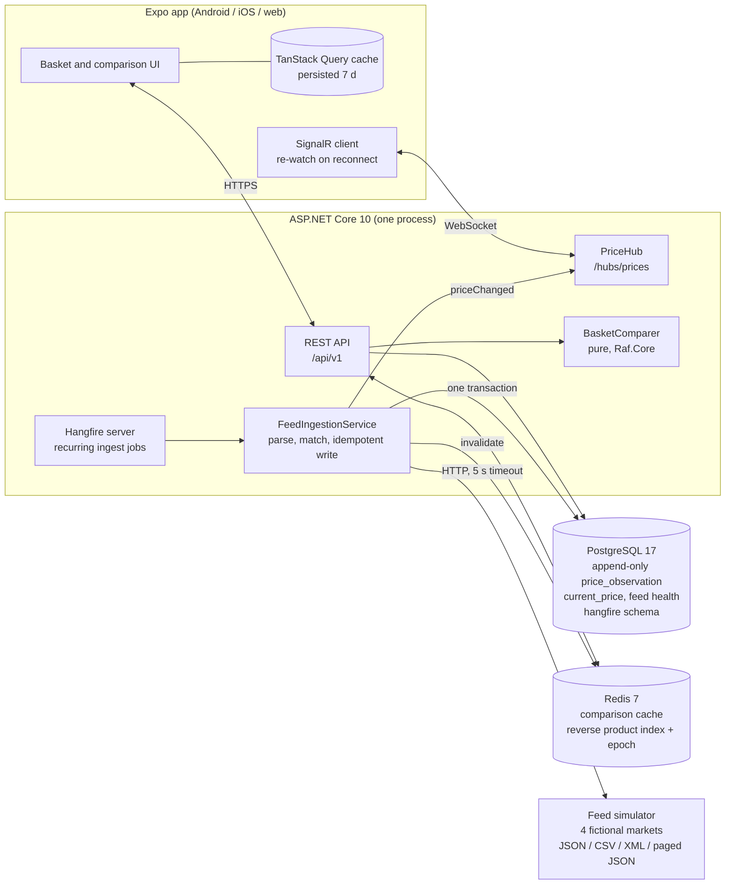

# raf

[](https://github.com/hekimcan206/raf/actions/workflows/ci.yml)
[](https://github.com/hekimcan206/raf/actions/workflows/codeql.yml)


[](LICENSE)

**Grocery price comparison: the cost of the same basket in every market.** It works with prices that are hours or
days old and with a phone that loses its connection. Both are treated as normal operating conditions.
React Native (Expo), ASP.NET Core, PostgreSQL, Redis, SignalR, Hangfire.

*Raf* is Turkish for "shelf".

> **Status: in progress (v0.1).** The core is complete and tested end to end: matching, comparison, the freshness
> model, ingestion, cache, live updates and the offline-capable app. The feeds are simulated, and there are no user
> accounts or store locations yet. See the [roadmap](#status-and-roadmap).
>
> All data is synthetic: fictional markets, invented brands, and GTINs from the GS1 restricted-circulation range that
> never identify a real product. No real retailer is scraped or imitated, and no personal data is processed.



## Problem

Comparing "the same basket" across supermarkets sounds like `SUM(price)`. In practice three things get in the way:

1. **Identity and quantity.** Market A lists "Ovacık Tam Yağlı Süt 1 L" by barcode, while market B has only its own
   SKU and calls the item "1 lt". Market C does not stock it at all, but sells the same milk in 500 ml packs.
2. **Prices are not equally current.** One market republishes every 10 minutes, another once a night. A third last
   touched some prices days ago. The public Market Fiyatı service that collects Turkish chain-store prices
   refreshes daily ([TÜBİTAK](https://tubitak.gov.tr/tr/haber/zincir-market-fiyatlarina-aninda-erisimin-onu-acildi)).
   A total built from prices of different ages and shown as current misleads the user.
3. **Connectivity.** Shoppers check prices in the aisle, where reception is poor, and feeds go down too.

## What it does

- **Compares a basket per market** with unit-price normalisation (per kg / L / piece), **substitutions** when a
  product is missing (same group, enough packs, at most 50 % extra), and **incomplete** markets ranked after complete
  ones, because a total with a gap is not comparable.
- **Freshness per line** (fresh ≤ 6 h, aging ≤ 24 h, stale ≤ 7 d, expired beyond), measured from the market's own
  `observed_at`. Each total reports **how much of its money rests on stale prices**. Expired prices are never used.
- **Ingests four simulated market feeds**: JSON, Turkish-format CSV, XML and a paged SKU-keyed API. Each feed has its
  own latency, failures, hangs and maintenance windows. Ingestion runs as **Hangfire recurring jobs on PostgreSQL**.
  It is idempotent (append-only history), monotonic (old feeds never roll prices back) and tracks feed health.
- **Redis cache** for hot comparisons, with **explicit invalidation** on price change. A reverse product index plus
  an epoch guard keeps a result computed from old prices from being written back.
- **SignalR** pushes price changes to the clients whose basket contains the product.
- **Expo app** (Android, iOS and web): builds the basket offline, keeps the last comparison for 7 days with "as of"
  age badges that keep ageing on the device, warns about stale prices, and resyncs after reconnecting (pushes the
  basket, re-watches products, refetches).

| | | |
|-|-|-|
|  |  |  |
| Cheapest complete basket, substitution, per-line age badges | Tazelik: 47 % of the total rests on prices older than 24 h | Çarşı looks cheapest but misses an item: struck through, ranked last |
|  |  |  |
| Offline: saved result stays, with its age | Restarted with the server down: persisted cache renders | Basket: catalogue with lowest price and coverage |

*Screenshots: Expo web build in a 412 × 915 viewport, captured by Playwright against `docker compose up`
([tools/screenshots](tools/screenshots)).*

## Architecture



What happens when a price changes:

```mermaid
sequenceDiagram
    participant J as Hangfire job
    participant PG as PostgreSQL
    participant R as Redis
    participant H as PriceHub
    participant A as App
    J->>PG: append observations (ON CONFLICT DO NOTHING) + upsert current_price WHERE newer
    PG-->>J: changed (product, market, old → new)
    J->>R: INCR epoch; DEL entries indexed under changed products
    J->>H: priceChanged → group product:{id}
    H-->>A: priceChanged
    A->>A: banner "A price in your basket changed"
    A->>A: refetch comparison (miss → fresh from PostgreSQL)
```

## Why this design

| decision | instead of | why | ADR |
|----------|------------|-----|-----|
| Freshness per price from the market's `observed_at`, money-weighted stale share, expired prices excluded, labels computed at read time on server *and* device | one "last updated" timestamp, or hiding non-fresh prices | a total mixes prices of very different ages; a saved result must keep ageing while offline | [0001](docs/adr/0001-stale-prices-and-disconnection.md) |
| Feed health reported separately from freshness | "market is stale" | a down feed can have minute-old prices, and a healthy nightly feed has 20-hour-old ones | [0001](docs/adr/0001-stale-prices-and-disconnection.md) |
| GTIN-14 identity, curated SKU mapping, size cross-check; curated substitution groups with an overbuy cap | fuzzy name matching | wrong matches make totals untrustworthy, silently | [0002](docs/adr/0002-product-matching-and-unit-normalisation.md) |
| Redis cache-aside, reverse product index, epoch check-and-set, Redis optional | TTL-only caching or flush-all | correct after a price change, targeted, and no stale writes from in-flight requests | [0003](docs/adr/0003-comparison-cache-and-invalidation.md) |
| Hangfire on PostgreSQL, no automatic retries, per-market advisory lock, all-or-nothing runs, DML-only app role | `BackgroundService` timers, Quartz | scheduling, history and multi-instance coordination for free; the schedule is the retry | [0004](docs/adr/0004-hangfire-ingestion-on-postgresql.md) |
| Append-only `price_observation` enforced by grants; monotonic `current_price` | updating a price row | history is evidence; a replayed old feed must not roll prices back | [0004](docs/adr/0004-hangfire-ingestion-on-postgresql.md), [job plan](docs/hangfire-job-plan.md) |
| Integer kuruş end to end | decimals or floats | no rounding drift between parse, sum and display | [0002](docs/adr/0002-product-matching-and-unit-normalisation.md) |

## Quick start

Requirements: Docker. For development: .NET SDK 10.0.4xx and Node 22+.

```bash
docker compose up --build
```

| | |
|-|-|
| App (Expo web build) | <http://localhost:58281>: tap **Try the sample basket** |
| API reference (Scalar) | <http://localhost:58280/scalar> |
| Hangfire dashboard (read-only, local only) | <http://localhost:58280/hangfire> |
| Feed health / runs | <http://localhost:58280/api/v1/markets>, `/api/v1/feeds/runs` |

Things to try:

```bash
# Force a price change in one market; within a minute the job ingests it and the app shows the banner and new total
curl -X POST localhost:58282/admin/markets/bereket/prices -H 'content-type: application/json' \
     -d '{"gtin":"2000000000015","priceKurus":3333}'

# Take a market's feed down for 5 minutes; its health goes degraded → down, its prices keep ageing
curl -X POST "localhost:58282/admin/markets/carsi/outage?seconds=300"

# Compare an ad-hoc basket
curl -s localhost:58280/api/v1/comparisons -H 'content-type: application/json' \
     -d '{"items":[{"productId":"<id from /api/v1/products>","quantity":2}]}'
```

In the browser, toggle devtools → Network → Offline to see the offline banner. The saved comparison stays on screen.

Development:

```bash
dotnet test                               # 149 tests: unit, property, golden + Testcontainers (Docker required)
cd mobile && npm ci && npm test           # 50 Jest tests
cd mobile && EXPO_PUBLIC_API_URL=http://localhost:58280 npx expo start --web   # against the compose API
```

## Results

| what | measured |
|------|----------|
| .NET tests | **149 passed**: 121 unit, property (FsCheck) and golden tests, plus 28 integration tests on real PostgreSQL 17 + Redis 7 via Testcontainers (ingestion, cache invalidation and epoch race, SignalR end to end, Hangfire job as the DML-only role) |
| App tests | **50 Jest tests**: freshness ageing, resync rules, banners, basket, backoff, money formatting |
| Comparison latency, 10-line basket, sequential (median of 3 runs) | Redis hit **p50 1.41 ms / p95 3.66 ms** vs uncached p50 2.45 / p95 6.43 ms; miss p50 3.50 / p95 8.69 ms |
| Throughput, 16 concurrent clients | hit **4,164 req/s** vs uncached 2,624 req/s (p95 10.4 vs 12.7 ms) |
| Ingestion idempotency | re-reading an unchanged feed inserts **0** observations and reports **0** changes (integration test) |

Full method, environment, raw runs and caveats: [docs/benchmarks.md](docs/benchmarks.md). On this small demo
catalogue the database path is already fast. The cache saves about 1 ms per hit and costs about 1 ms per miss, and
the doc says so rather than projecting gains for larger catalogues.

## Status and roadmap

**Done (v0.1):** the comparison engine with substitutions and unit prices, the freshness model, four feed formats,
Hangfire ingestion with feed health, Redis caching with invalidation, SignalR updates, the offline-capable Expo app,
compose demo, CI.

**Next:**

1. Branch-level prices and "nearest branch" (needs location consent; a KVKK assessment first).
2. Accounts and shared household baskets, with optimistic concurrency already in the API (`If-Match`).
3. A real feed adapter behind `IFeedFormat`, for a retailer that offers an API or file feed under terms that allow it.
   Scraping is out of scope.
4. Per-market cache entries (finer invalidation) and a Redis backplane for SignalR when running more than one API
   instance.
5. Price-history charts in the app (the API already serves `/products/{id}/prices`).
6. Native builds (EAS) and device testing. Only the web build is exercised in CI today.

## Limitations

- Feeds are **simulated**. The formats are realistic but synthetic, and real retailer data will differ.
- One API process runs both the HTTP endpoints and the Hangfire server. SignalR has no backplane, so a second instance
  would need Redis-backplane SignalR (or a separate worker), and the cache's Lua scripts are single-node.
- The device clock is trusted for ageing labels.
- Missed SignalR pushes are not replayed. The client refetches after reconnecting instead, which is correct but costs
  one request.
- Only the Expo **web** build is screenshot-tested. Native behaviour (NetInfo, AsyncStorage on device) uses the same
  code paths, but no device was tested.

## Privacy (KVKK) and security

No personal data is processed. Baskets are anonymous and identified by a device-generated UUID, and there are no
accounts, names, locations or payment data. KVKK is the Turkish personal data protection law. If accounts or
location features are added, a data inventory and retention policy come first. The threat model is in
[docs/threat-model.md](docs/threat-model.md). Highlights: append-only price history enforced by PostgreSQL grants,
DML-only application role (also for Hangfire), XXE-safe XML parsing, parameterised SQL, non-root chiseled images.

## Repository layout

```
src/Raf.Core            domain: GTIN, pack sizes, freshness policy, basket comparer, feed formats (pure, no I/O)
src/Raf.Api             ASP.NET Core API, ingestion, Hangfire jobs, Redis cache, SignalR hub, migrations, demo seed
src/Raf.Simulation      deterministic price model, fictional catalogue, feed writers
src/Raf.FeedSimulator   the four simulated market feeds (+ admin endpoints for demos and tests)
mobile/                 Expo app (TypeScript), Jest tests, nginx config for the web build
tests/                  unit/property/golden tests; Testcontainers integration tests
benchmarks/             HTTP latency harness
tools/screenshots       Playwright capture of README images and GIF
docs/                   ADRs, Hangfire job plan, benchmarks, threat model
```

## License

[MIT](LICENSE)
